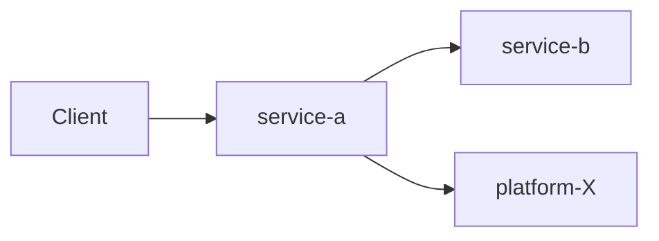

# <ProjectName> Architecture — System View

> This is an orchestration repo: it describes the whole system across service repos.
> Describe topology, ownership, and system-level flows; link out to each service repo
> for internals — never copy service-repo content here.

> Source: <docs/services.md entries / service repos' AGENTS.md & architecture.md>
> Last-verified: <YYYY-MM-DD>

---

## System Positioning

<!-- One sentence: what does the whole system do, who is it for?
     E.g. "Online retail platform spanning order, inventory, payment, and ops backends". -->

---

## System Topology

<!-- Mermaid diagram of service topology and platform (中台) integration surfaces.
     Nodes are services from docs/services.md; edges are real call/event paths. -->

---

## Service Breakdown

<!-- One row per service from docs/services.md. Capabilities/ownership come from the
     synced view in service-dependencies.md; link, do not duplicate. -->

| Service | Repo | Responsibility | Key Downstream | Owner |
|------|------|---------|---------|---------|
|  |  |  |  |  |

---

## Typical Cross-Service Flows

<!-- End-to-end flows that span services: trigger, call topology across services,
     data exchanged, and what fails where when a hop goes down. -->

---

## Key Cross-Service Decisions

| # | Decision | Notes |
|---|------|------|
|  |  |  |
